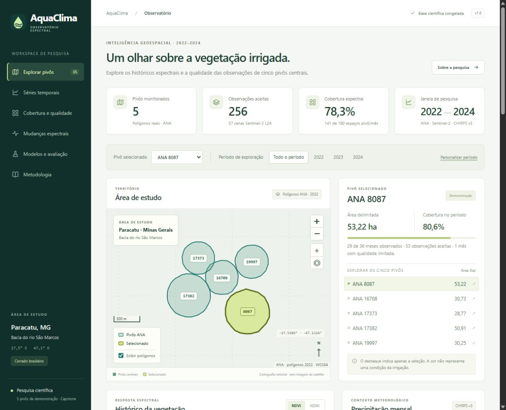
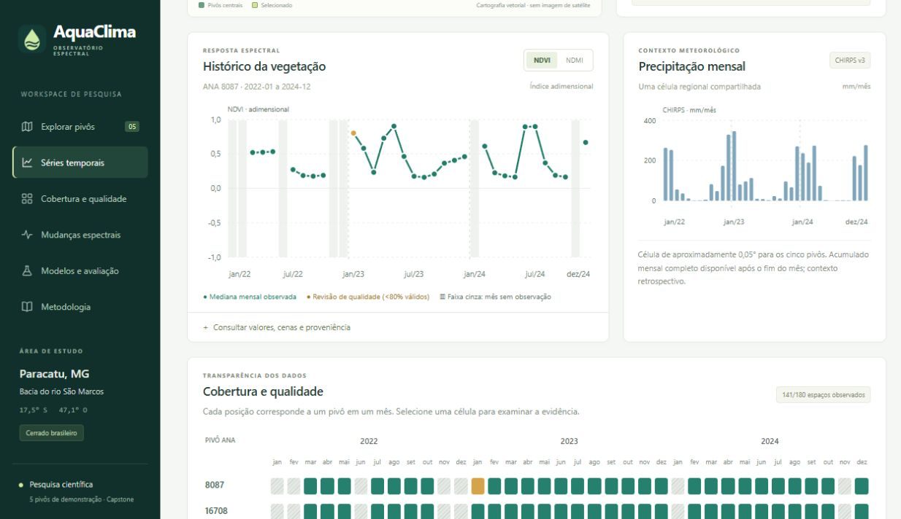
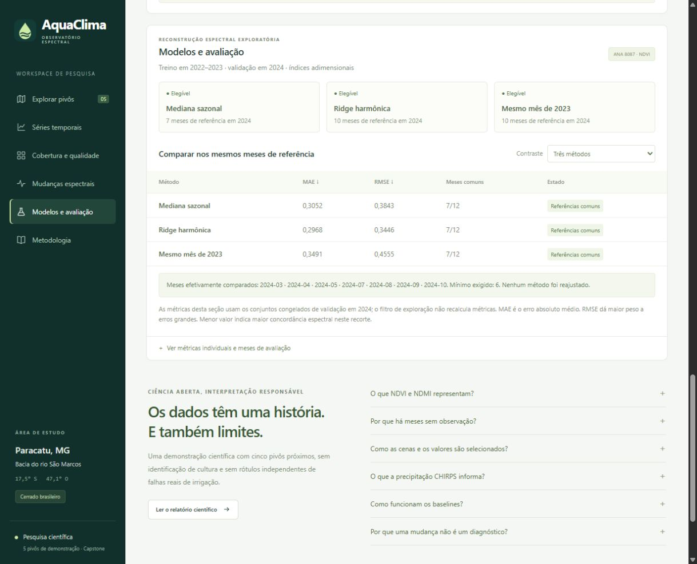
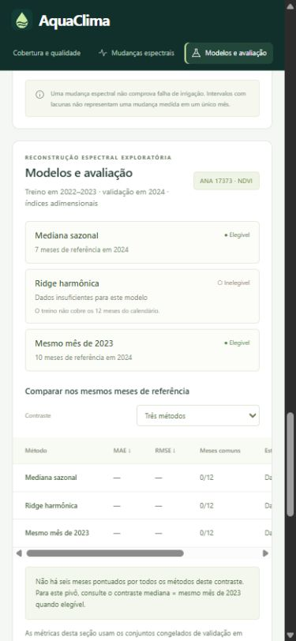

# Entrega do WebGIS científico — Fase 4

Verificação local concluída em 11 de novembro de 2026. Branch de trabalho: `codex/aquaclima-webgis`, criada a partir do commit científico congelado `1440f3e5b28736d12ded226d6baa6b5ca9005262`. A aplicação funciona localmente; a publicação remota permanece pendente de acesso de escrita e configuração do GitHub Pages.

## Aplicação entregue

- Mapa Leaflet sem tiles externos, com os cinco polígonos ANA reais, seleção por clique/teclado, enquadramento, zoom, escala, norte, coordenadas e controle de camada.
- Seleção sincronizada de pivô, NDVI/NDMI e período; estado compartilhável pela URL e navegação por âncoras compatível com GitHub Pages.
- Séries mensais com lacunas preservadas, pontos com valores/datas/qualidade, tabela de cenas e proveniência radiométrica.
- Precipitação CHIRPS mensal em mm, explicitamente regional e retrospectiva, compartilhada pelos cinco pivôs.
- Matriz de cobertura por pivô/mês/ano: válida, ausente, qualidade limitada e aquisição incompleta. Os dados reais atuais não contêm aquisição incompleta.
- Mudanças espectrais provenientes de `events.csv`, com valores, diferenças, intervalos, meses sem observação e evidências de origem.
- Elegibilidade e métricas individuais dos três baselines; comparação exclusivamente nas interseções congeladas de meses comuns. Ridge indisponível conserva métricas ausentes.
- Metodologia, limitações, documentos científicos, manifesto público e identificadores de integridade acessíveis na interface.
- Layout responsivo, foco visível, suporte a movimento reduzido, estados de falha explícitos e tooltips por mouse e teclado.

O código completo está em [`web/`](../web/). A arquitetura, contratos, política de publicação e instruções detalhadas estão em [`webgis.md`](webgis.md). O snapshot permitido está em [`web/data/manifest.json`](../web/data/manifest.json); nenhuma instalação nova precisa dos rasters ou caches para executar o frontend.

## Execução local

Na raiz do repositório, em PowerShell:

```powershell
Set-Location web
npm ci
npm test
npm run build
npm run preview
```

Abra `http://127.0.0.1:4173/FTL-Final-Project/`. O build final pode ser servido por um servidor HTTP estático comum. `npm run dev` serve a versão de desenvolvimento com Vite. Não abra o HTML por `file://`.

Para os testes reais de navegação:

```powershell
Set-Location web
npx playwright install chromium
npm run test:browser
```

Nesta máquina, os testes foram executados usando o Edge local, que usa Chromium, com `PLAYWRIGHT_CHANNEL=msedge` e `PORT=4174`. O CI está configurado para instalar e testar Chromium. O CI remoto ainda não foi executado nesta entrega.

## Validação e build observados

| Verificação | Resultado local |
| --- | --- |
| Suíte científica original | **193 aprovados**, 19,98 s |
| Contratos, corrupção, privacidade e exportação determinística | **15 aprovados** |
| CSV, filtros, qualidade, correspondência dos gráficos e meses comuns | **8 aprovados** |
| Navegação real no Edge/Chromium | **11 aprovados**, 12,0 s na execução final |
| Build Vite de produção | **Aprovado**; valida o pacote antes de compilar |
| Site estático final | **21 arquivos, 1.143.010 bytes** em `web/dist/` |
| Requisições HTTP externas e erros de console nos cenários saudáveis | **Nenhum** |
| Cenários deliberados de dados ausentes/adulterados | Falha visível, sem resultados inventados |
| Arquivos científicos versionados | Sem diferença em `src/`, `tests/`, `configs/`, `pyproject.toml` e `uv.lock` |
| Branch `main` | Preservada em `b5d45f8133e229ca5b156b64781599cadfc269a6` |

Os onze cenários do navegador cobrem os cinco pivôs e os valores reais, NDVI/NDMI, períodos e entradas inválidas, precipitação, qualidade, eventos, Ridge elegível/inelegível, meses comuns, mapa por teclado, camada, tooltips, recarga, hash e assets sob `/FTL-Final-Project/`, largura móvel de 390 px, contraste mínimo de 4,5:1 em notas/KPIs/métricas representativos, movimento reduzido, HTTP 404 e SHA-256 adulterado. Os testes verificam os valores dos pontos contra o snapshot, sem usar dados inventados na demonstração. A verificação de contraste é representativa e não equivale a uma auditoria completa de conformidade WCAG.

O build empacota Leaflet e todos os assets de runtime. Não carrega fontes, scripts, imagens ou mapas de CDN. A pasta `web/dist/` é o artefato Pages, incluindo `.nojekyll`; dependências npm, código Python, rasters, caches e ambientes virtuais ficam fora dele. Também foi gerado o arquivo local `build/aquaclima-webgis.zip`, contendo somente `dist/`, com SHA-256 `0e0b5a99f28a5650be8982f60ec857f0596b0a553426610ace928e14080b38ad`.

## Integridade científica

O manifesto de origem real é `data/recovery/curated/2022_2024_recovery_v1/webgis/manifest.json`. O pacote original é `16094dc7ef7ae3e6881b86bc0cbb0ff7b146f0558fc0947957865026882360a3`. Seus 11 arquivos centrais foram preservados byte a byte no pacote público `7a072a6e29688039b5b775663262ecf6338b35c41386264e75ee789f93068a4d`, que acrescenta os resultados congelados da comparação comum e o registro de publicação.

Após a integração, os hashes dos CSVs científicos originais continuam:

- Observações: `0b1341b57615a5503a68fc8e3e54983f96fd6129ab463c63a517dce6cf05a780`.
- Mensal: `d78469f3dd13287d390aa75cceaa745e1dbf9ed83a1b4efbf18a17718e64fc7a`.

`npm run data:export` reproduz o snapshot a partir dos contratos e da comparação já disponíveis localmente, sem aquisição, ajuste ou escrita nos originais. O teste de reprodução confirma todos os bytes. `web/data/** -text` em `.gitattributes` impede conversão automática de fim de linha no checkout dos dados. A validação também rejeita arquivos laterais e pacotes antigos na árvore pública, para evitar que sejam copiados acidentalmente ao site.

A varredura do subconjunto público não encontrou caminhos absolutos, credenciais ou URLs assinadas. Os identificadores relativos dos inventários, IDs de cena, baselines textuais, métodos e hashes de calibração foram conservados.

## Capturas reais

Capturas do build servido localmente, sem montagem ou geração de imagens:









## Publicação pendente e próximos passos

Não há link público de deployment confirmado nesta entrega. A ferramenta GitHub conectada informou `push=false` e `admin=false`; `gh auth status` também informou credencial local inválida. Nenhum push, merge, alteração de `main` ou configuração remota de Pages foi feito.

O workflow [`webgis.yml`](../.github/workflows/webgis.yml) já prepara a validação, os testes, a compilação e o deployment de `web/dist/`. Uma pessoa com as permissões necessárias deve:

1. Selecionar **Settings → Pages → Source → GitHub Actions** e conferir as regras do environment `github-pages` para a branch `codex/aquaclima-webgis`.
2. Restaurar autenticação de escrita e enviar essa branch com `git push -u origin codex/aquaclima-webgis`.
3. Aguardar a aprovação dos jobs científicos e do frontend e confirmar a URL retornada pelo job `deploy`.
4. Repetir o roteiro documentado na URL pública e no notebook/projetor do Capstone, registrar a versão final e preparar a apresentação para **24/11/2026**.

As limitações científicas permanecem: cinco pivôs próximos, meses ausentes e seleção desigual entre estações; cultura e manejo desconhecidos; dependência espacial/temporal; nenhum rótulo independente de falha real de irrigação. Ridge é elegível somente em dois pivôs. A interface não comprova diagnóstico hídrico ou generalização a outras áreas. O mapa mostra somente os polígonos e a grade cartográfica própria. O frontend não armazena dados offline por service worker: para abrir uma nova sessão, os arquivos estáticos precisam ser servidos por HTTP.
