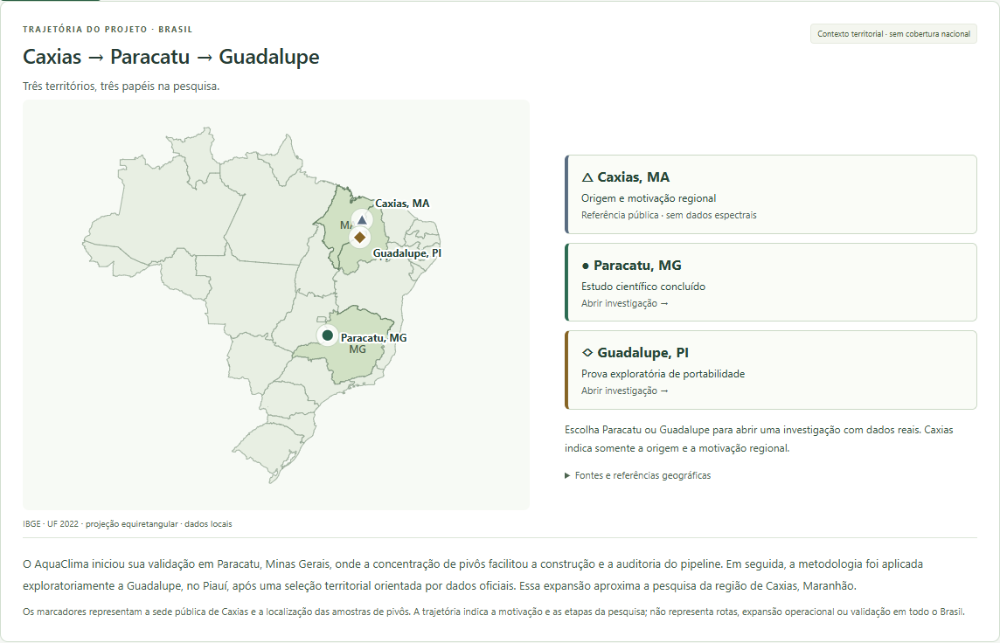
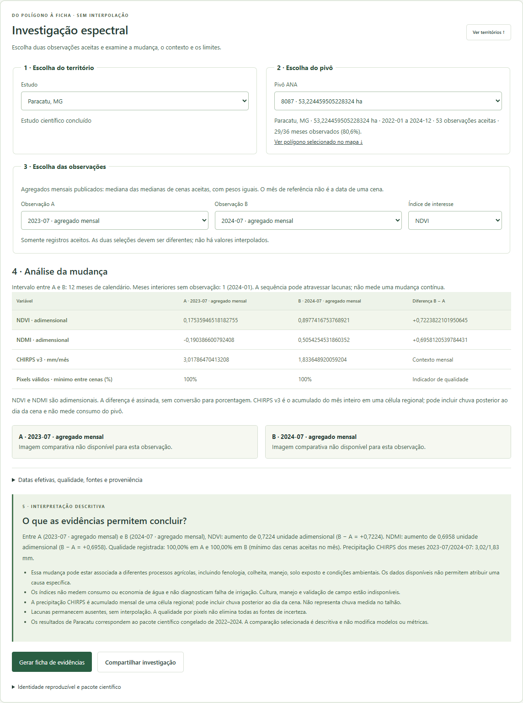
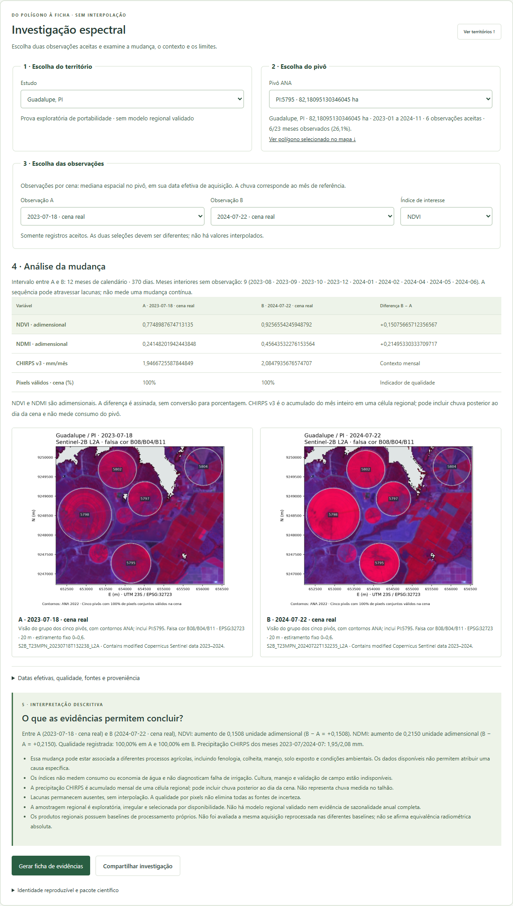
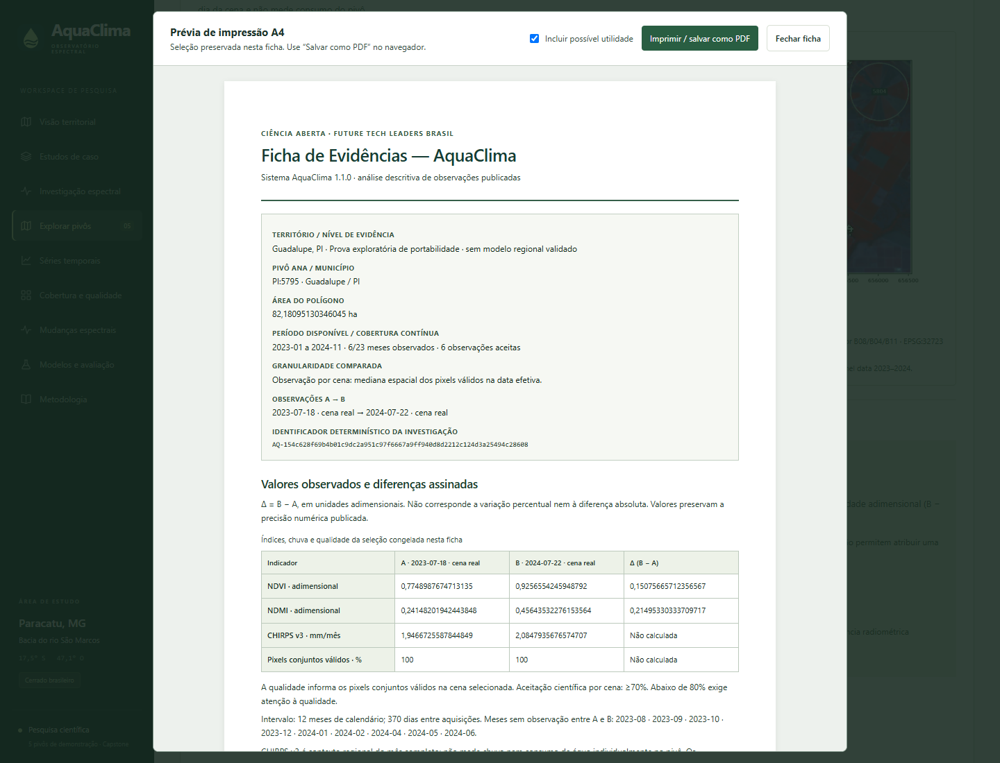
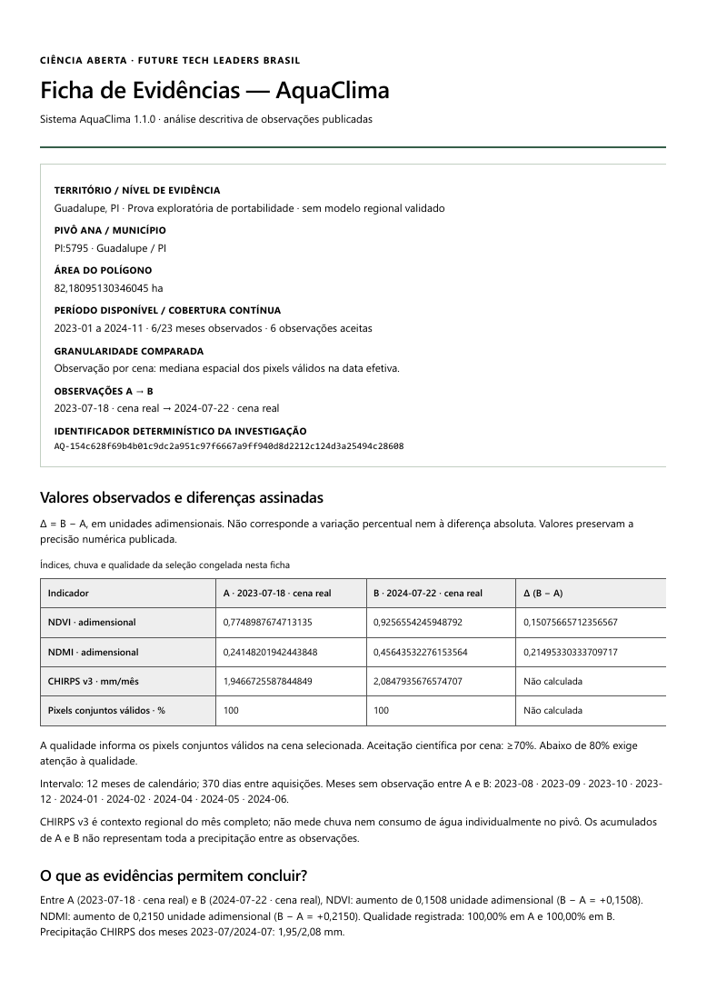
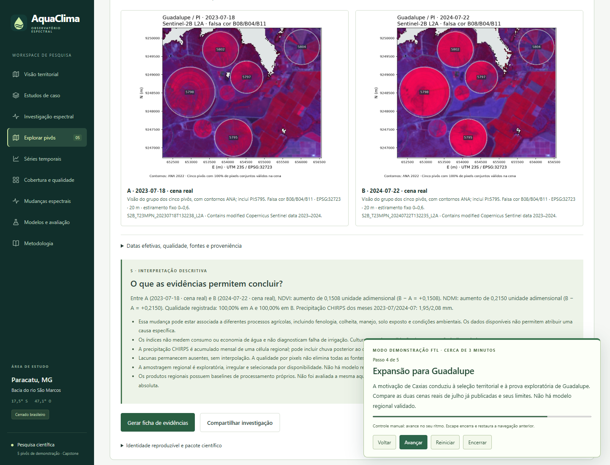
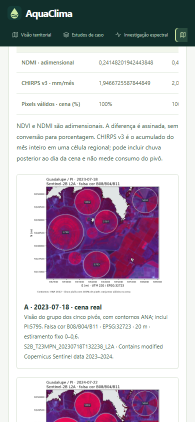

# Investigação guiada e fichas de evidências — Fase 7

Referência: **16/11/2026**, America/Sao_Paulo. Sistema frontend **1.1.0**. Base de implementação: `main`, merge do PR #2, commit `ffb7ba41d5286fd58c47acd8007903fd38b799d4`. A branch `codex/aquaclima-investigacao-ftl` aguarda revisão e merge manual. Nenhuma publicação ou nova aquisição científica faz parte desta fase.

## Experiência entregue

A visão territorial apresenta o Brasil e os três papéis geográficos. Caxias é a origem e a motivação do pesquisador, sem observações espectrais processadas. Paracatu abre o estudo científico concluído e Guadalupe abre a prova exploratória de portabilidade. A escolha de estudo ou pivô sincroniza a investigação com os mapas e controles existentes. Os gráficos e modelos históricos continuam explicitamente vinculados a Paracatu. Os filtros desse observatório são preservados ao retornar da região exploratória.

A seção **Investigação espectral** organiza cinco etapas: território, pivô, duas observações aceitas, análise da mudança e interpretação. Mostra área, período contínuo, cobertura do pivô, contagem de observações, NDVI/NDMI, deltas assinados, qualidade, chuva, lacunas e proveniência. O seletor do índice destaca a linha correspondente e sincroniza o índice do estudo. Nenhum modelo é executado no navegador.

O botão **Gerar ficha de evidências** congela a seleção numa prévia independente e permite imprimir ou salvar como PDF pelo navegador. **Compartilhar investigação** fornece um link com seleção e hash do pacote. Se o clipboard não estiver disponível, o campo permite copiar manualmente.



## Arquitetura e integração

| Componente | Responsabilidade |
|---|---|
| `web/src/data.js`, `regions.js` | Carregadores existentes, validação dos contratos e SHA-256 antes da apresentação |
| `investigation-data.js` | Projeções de apresentação, seleção, comparação, ausências, imagens, URL e identidade determinística; funções puras, exceto SHA-256 assíncrono |
| `investigation.js` | Interface das cinco etapas e seleção única usada por ficha, URL e demonstração |
| `evidence-report.js` e CSS | Cópia imutável, escape de dados, prévia em diálogo, documento em fluxo normal para impressão A4 |
| `demo-mode.js` e CSS | Cinco passos manuais, progresso, controles e restauração por callbacks |
| `territorial-overview.js`, `brazil-states.json` e CSS | Malha IBGE local e referências geográficas versionadas de apresentação |
| `app.js`, `regional-ui.js`, `map.js` | Coordenação com os mapas, gráficos e controles já existentes; captura/restauração das vistas |
| `web/scripts/capture-investigation.mjs` | Capturas autênticas e PDFs de QA sobre o artefato de produção |

O carregador regional continua isolado: falhas locais no catálogo, pacote ou imagens apresentam aviso sem impedir o estudo congelado de Paracatu. A carga regional e seus blobs verificados são reaproveitados pela investigação. Não há segundo pipeline, cópia de modelos, transformação analítica de imagens ou cálculo de novos agregados mensais. O único cálculo novo é a diferença entre valores publicados e o intervalo/calendário da seleção.

## Contratos, fontes e integridade

O contrato WebGIS permanece em **1.0.0**. A versão **1.1.0** identifica o sistema frontend, e **1.0.0** identifica os parâmetros de apresentação da investigação. Não são versões novas dos resultados científicos.

| Evidência preservada | Identidade |
|---|---|
| Paracatu | `2022_2024_recovery_v1` |
| Pacote público Paracatu SHA-256 | `7a072a6e29688039b5b775663262ecf6338b35c41386264e75ee789f93068a4d` |
| `web/data/manifest.json` SHA-256 | `69fb2f8083daaf2cc8bcb4b062bb922d36b40ea849468b778d3397aae1ae49b8` |
| Guadalupe | `2023_2024_exploratory_v1` |
| Pacote regional SHA-256 | `8d7a54f09174e5890f8a8babf153df855699c727d639b7868a94a658a7495131` |
| `web/regions/catalog.json` SHA-256 | `afda1abd42ddc472c83db3f6b3953f18e86b19dea954200731f7fb4e70b7384b` |

Os bytes de `web/data/**`, `web/regions/**`, das evidências científicas regionais e dos arquivos científicos congelados não foram alterados. `data:validate`, `regions:validate` e o build verificam os hashes e contratos originais. `verify:dist` compara as cópias publicadas byte a byte com os snapshots versionados e recusa arquivos privados, recursos remotos de runtime e assets não referenciados. O registro de execução e as capturas ficam em [evidencias/fase7/verificacao.json](evidencias/fase7/verificacao.json).

As fontes analíticas permanecem ANA/SNIRH, Sentinel-2 L2A e CHIRPS v3. A ficha conserva IDs, provedor, coleção, baseline, método, fonte e hashes publicados. Onde não há campo publicado, mostra ausência. Não se confunde hash da tabela/pacote com hash de um raster CHIRPS: este último permanece explicitamente ausente quando não consta do pacote público.

## Regras temporais e exemplos reais

**Paracatu** usa exclusivamente linhas `monthly_status=ok` da tabela mensal que possuem cenas aceitas correspondentes. Cada linha já é a mediana das medianas espaciais de cenas aceitas com pesos iguais. O mês de referência é distinguido das datas efetivas de todas as cenas que compõem o agregado. O exemplo da demonstração usa o primeiro pivô publicado, `8087`, em julho/2023 e julho/2024, ambos verificados no pacote. Não existe um intervalo diário único entre dois agregados mensais.

**Guadalupe** usa observações por cena realmente aceitas para o pivô selecionado. Uma data rejeitada, como 24/03/2024 em `PI:5802`, não aparece como opção. Se várias cenas compartilhassem o mesmo dia, teriam IDs distintos, mas não poderiam formar uma comparação de datas diferentes. O exemplo visual usa `PI:5795` nas aquisições de **18/07/2023** e **22/07/2024**, que distam 370 dias e 12 meses de calendário.

Os valores completos vêm dos números publicados; `delta_ndvi = ndvi_B − ndvi_A` e `delta_ndmi = ndmi_B − ndmi_A`. Inverter A/B inverte o sinal. Nenhuma diferença percentual ou absoluta substitui esse cálculo. A interface lista os meses interiores sem observação no calendário contínuo do pivô, sem preencher lacunas. Meses observados fora dos extremos não são classificados como ausentes.

A chuva é recuperada por **pivô e mês** com `precip_status=ok`; valores vazios permanecem ausentes e zero real permanece zero. O acumulado é do mês inteiro, pode incluir chuva posterior ao dia da cena e não representa a chuva acumulada de todo o intervalo A–B. A qualidade mensal é o mínimo de pixels válidos entre as cenas aceitas, enquanto a qualidade por cena pertence à aquisição selecionada. Consulta completa, estado do lote e revisão de qualidade ficam acessíveis na proveniência.



## Imagens reais e limites de interpretação

As duas imagens de Guadalupe já publicadas são reaproveitadas, com SHA-256 conferido pelo carregador. A disponibilidade exige correspondência exata de região, pivô aceito, cena, data e hash do derivado. São visões do **grupo dos cinco pivôs**, com contornos e IDs ANA, não novos recortes individuais. Em outra data, a interface e a ficha mostram: “Imagem comparativa não disponível para esta observação.” Paracatu não recebe imagens emprestadas de Guadalupe.

A composição falsa cor é R=B08, G=B04, B=B11, EPSG:32723, grade de 20 m, com estiramento fixo 0–0,6. As legendas preservam datas, IDs, atribuição Copernicus, grade e parâmetros. Nenhuma imagem nova foi adquirida ou gerada para simular evidência.



A síntese usa templates determinísticos a partir dos valores, deltas, qualidade e chuva reais. As limitações distinguem fenologia, colheita, manejo, solo e ambiente como possibilidades, sem atribuir uma causa. Não há serviço de linguagem externo, diagnóstico de falha de irrigação, alegação de economia de água ou ganho econômico. Guadalupe continua exploratória: 29/30 tentativas aceitas, 29/115 espaços no calendário de 23 meses, sem modelo regional validado. O protocolo e as métricas de Paracatu, incluindo a exclusão de 2025, permanecem intactos.

## Ficha A4 e reprodutibilidade

A ficha inclui sistema/versão, região/status, pivô/área, observações, valores completos, deltas, chuva, qualidade, proveniência, imagens correspondentes, síntese, limitações, pacote/versão/hashes, parâmetros, links e data de geração em UTC. A data da ficha aparece separada das datas dos dados. A seção opcional **Possível utilidade da investigação** pode ser retirada antes da impressão.

`createEvidenceSnapshot` faz uma cópia profunda antes da identificação assíncrona e congela todos os objetos. Alterar a investigação depois não altera a ficha. Uma cópia equivalente em fluxo normal é usada exclusivamente na impressão: evita cortes do diálogo nativo em páginas subsequentes. Não existem pop-ups, CDNs, bibliotecas PDF pagas ou envio de dados. Fechar remove ambas as cópias e devolve o foco ao botão gerador. As imagens são decodificadas antes de chamar `window.print()`; uma falha visual vira mensagem explícita.

O identificador `AQ-<SHA-256>` deriva de região, pivô, IDs das observações/cenas, versão e hash do pacote e parâmetros ordenados (granularidade, sinal B−A, índice, versão de apresentação e regra de ausências). A data de geração não participa. O exemplo de Guadalupe em `PI:5795`, 18/07/2023 → 22/07/2024 e NDVI resulta em `AQ-154c628f69b4b01c9dc2a951c97f6667a9ff940d8d2212c124d3a25494c28608`.



Os PDFs de QA produzidos pelo Edge têm texto selecionável, A4, cinco páginas no exemplo mensal e quatro no regional. Todas as páginas foram renderizadas pelo Poppler e inspecionadas: números e IDs completos, contraste em escala de cinza, tabela preservada, legendas e ausência dos controles da aplicação. O tamanho depende do número de cenas na seleção. São exemplos de QA em `build/phase7-print/`, não novos documentos científicos congelados. As opções do diálogo de impressão e os cabeçalhos/rodapés próprios do navegador continuam sob controle do usuário.



## URLs e entradas inválidas

Os links preservam `region`, `pivot`, `a`, `b`, `indice`, `section=investigacao`, `package` e o fragmento `#investigacao`. `pivot`, `indice`, `from` e `to` antigos continuam funcionando para Paracatu. O período de exploração é preservado, mas não restringe silenciosamente as opções aceitas da investigação. A tabela comparativa informa os próprios extremos A/B.

IDs são validados contra o estudo carregado. Região/pivô/observações inválidos recebem correção explícita para registros reais; datas iguais não são permitidas. Um hash diferente do publicado **bloqueia** valores, exportação e compartilhamento. O botão **Abrir pacote publicado atual** inicia conscientemente uma investigação sobre o pacote disponível. Não há promessa de que uma versão futura arquivará automaticamente pacotes antigos. O serializador descarta parâmetros desconhecidos e não inclui campos pessoais, credenciais ou caminhos locais.

## Demonstração FTL e restauração

**Iniciar demonstração** abre um roteiro não modal sobre o WebGIS real. Seus cinco passos são problema, Paracatu, investigação, Guadalupe e conclusões/limitações. Os pares são obtidos das observações aceitas: os dois meses de julho de Paracatu e as duas cenas com imagens verificadas de Guadalupe. Não há números de resultado fixados para sustentar uma narrativa.

Avançar, Voltar, Reiniciar e Encerrar funcionam com teclado; o progresso e o passo atual estão rotulados. Não há avanço automático. Escape fecha primeiro uma ficha aberta e, depois, encerra a demonstração. Ao encerrar, restaura seleção A/B, índice, filtros históricos, contraste de modelos, lista de mudanças, estudo regional, pivô regional, vistas dos mapas já existentes, URL, rolagem e foco. Um mapa regional criado durante a demonstração pode permanecer inicializado, fechado no painel correspondente. A interface normal permanece acessível durante a demonstração.



## Cartografia territorial

`brazil-states.json` contém as **27 UFs**, em WGS84, da API oficial de malhas IBGE, referência 2022, qualidade mínima fornecida pelo produtor. Fonte: [API IBGE](https://servicodados.ibge.gov.br/api/v3/malhas/paises/BR?intrarregiao=UF&formato=application/vnd.geo%2Bjson&qualidade=minima&periodo=2022). Bytes: 98.502; SHA-256 `07c671aa87aa1ab296c446de6294df9827112782537b996c0a160284907e7c0f`. É uma camada derivada de apresentação, separada dos pacotes científicos.

O ponto de Caxias reproduz a sede municipal pública já auditada na seleção regional, fonte ANA, código IBGE 2103000: longitude −43,358539429000018°, latitude −4,8616749898404166°. Paracatu e Guadalupe usam centros das extensões dos polígonos publicados, com essa referência explicitada; não se apresentam como sedes municipais. Testes conferem as coordenadas contra as evidências originais. A projeção de contexto é equiretangular. Não se calculam rotas ou distâncias nesta visão. Legendas distinguem forma, rótulo e cor dos três papéis, e os marcadores também funcionam por teclado. Toda a navegação usa arquivos locais, sem tiles.



## Verificações executadas

| Verificação | Resultado da Fase 7 |
|---|---|
| Suíte científica Python | 216 aprovados |
| Node frontend, incluindo contratos e artefato | 60 aprovados |
| Política de publicação | 5 aprovados; workflow main-only inalterado |
| Playwright Edge sobre produção | 25 aprovados, 40,2 s; 16 existentes e 9 novos |
| Vite / `verify:dist` | Aprovados; 25 arquivos e três assets de aplicação |
| Fichas A4 | Dois exemplos reais, 5/4 páginas, texto e renderização conferidos |
| Apresentação | Oito slides, PPTX editável e PDF de backup raster; slides 7/8 atualizados |
| Clone limpo | `npm ci`, 216 testes Python, 60 frontend, cinco de política, build e artefato idêntico; sem rasters/caches científicos privados |

O SHA-256 final do artefato é `30c96116b9f84daa8dfee0fe4fa3dbd4a7457d2895524d423e56c44f89f8ba3f`, reproduzido no workspace e no clone limpo. O clone local foi criado por `git clone --no-hardlinks --single-branch --branch codex/aquaclima-investigacao-ftl` a partir do commit de código/testes `8f87d2c`. A revisão documental subsequente não altera esse artefato. Os testes adicionais incluem interação com Paracatu durante a carga regional e retorno sincronizado a partir de Guadalupe, para evitar sobrescrita assíncrona ou transporte indevido de hashes.

Os testes unitários cobrem seleção, isolamento regional, mês/cena, datas distintas, ausências, deltas, precipitação, proveniência, imagem exata, identidade, URL, ficha e navegação determinística. Os testes de navegador conferem números diretamente contra os arquivos públicos, mapas sincronizados, imagens/ausências, ficha independente, CSS/acionamento de impressão, links/reload/entradas inválidas, roteiro completo, Escape, mobile e ausência de erros de console/requisições externas obrigatórias. A política anterior de integridade e publicação não foi relaxada.

## Reprodução

Num clone da branch revisada, Node.js ≥22.12 e npm bastam para o WebGIS. Não copie `data/`, rasters, XMLs locais ou caches privados.

```powershell
Set-Location web
npm ci
npm run data:validate
npm run regions:validate
npm test
node --test ../.github/tests/webgis-workflow.test.mjs
npm run build
npm run verify:dist
# Chromium instalado localmente, ou Edge com a variável abaixo no Windows.
$env:PLAYWRIGHT_CHANNEL='msedge'
npm run test:browser
node scripts/capture-investigation.mjs
npm run preview
```

Abra `http://127.0.0.1:4173/FTL-Final-Project/`. Em CI, o workflow já instala o Chromium. A ciência continua reproduzível com Python 3.12 e dependências travadas: `uv sync --locked` e `uv run --no-sync python -m pytest -q`. Nesta máquina a mesma suíte foi executada diretamente por `.venv/Scripts/python.exe -m pytest -q --basetemp=build/pytest-phase7`.

O registro JSON complementa esta documentação com o digest final do artefato, a verificação de clone limpo e hashes das capturas. Os materiais de apresentação revisados estão em [apresentacao/README.md](apresentacao/README.md), preservando também a versão anterior.

## Limitações e entrega

A fase entrega engenharia de exploração e comunicação de evidências, sem descoberta agronômica nova ou validação operacional. Uma cena não publicada visualmente continua sem imagem. A prova regional não valida modelos e a referência a Caxias não constitui monitoramento. A versão de impressão foi verificada em Chromium/Edge; outros navegadores podem paginar com pequenas diferenças e devem usar A4.

Não foram alterados workflow, modelos, métricas, limiares científicos, pacotes ou resultados de 2025. O PR exige revisão humana. Depois do merge autorizado e do deployment main-only, deve-se executar a suíte contra a URL publicada antes de afirmar validação pública da Fase 7. A prioridade permanece concluir correções e integração até 20/11, reservar 21–22/11 para ensaio, congelar em 23/11 e submeter em 24/11.
