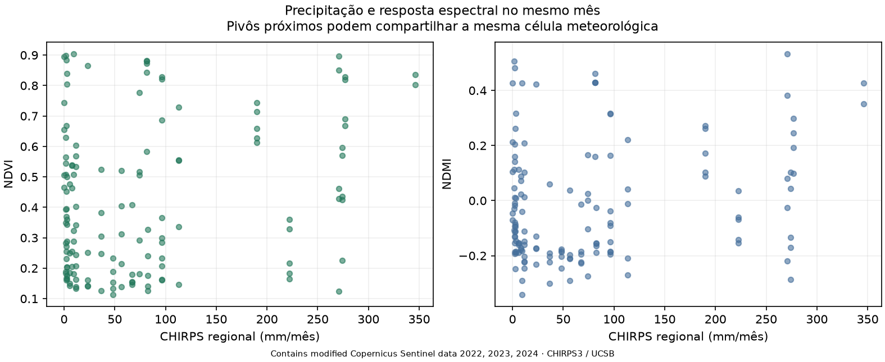
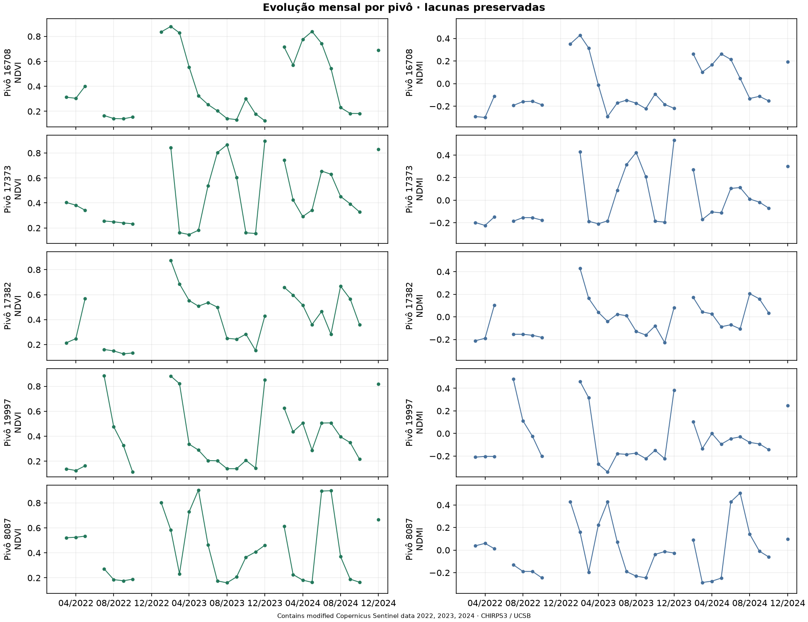
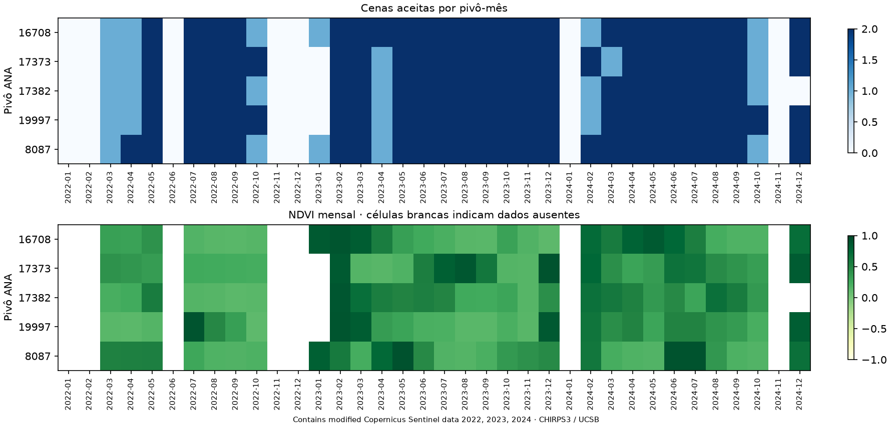
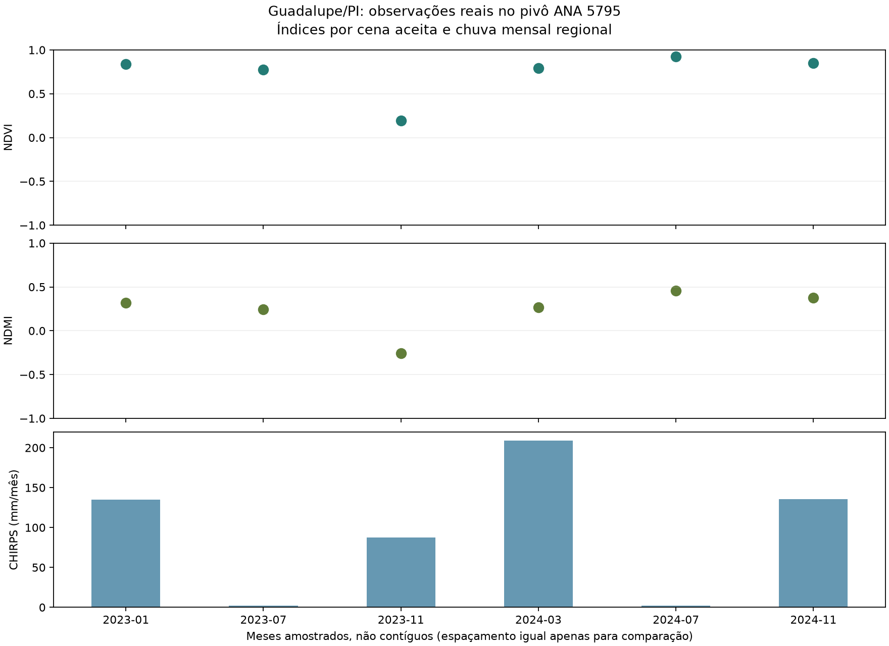
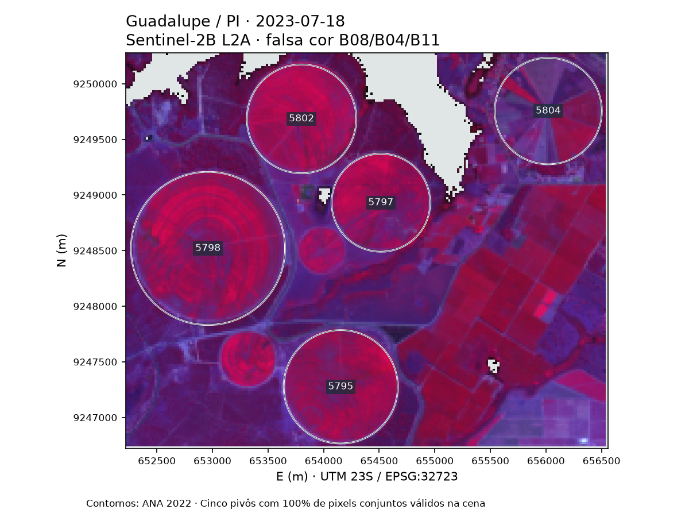
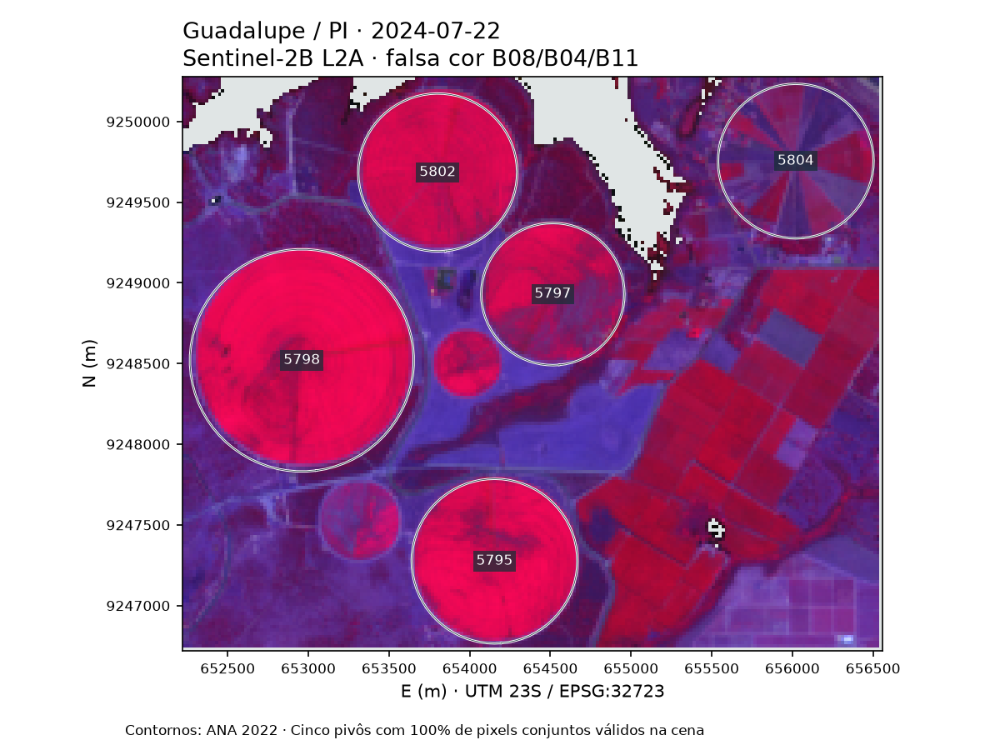

# AquaClima: monitoramento espectral reproduzível de áreas agrícolas irrigadas

**Autor:** Randerson Sousa de Sá Nunes. **Programa:** Future Tech Leaders Brasil, Capstone. **Origem territorial:** Caxias, Maranhão. **Data de referência:** 16 de novembro de 2026. **Entrega:** 24 de novembro de 2026.

**Código aberto:** [FTL-Final-Project](https://github.com/Altaeir-13/FTL-Final-Project). **Demonstração:** [WebGIS AquaClima](https://altaeir-13.github.io/FTL-Final-Project/). **Versão científica de Paracatu:** `2022_2024_recovery_v1`, congelada no commit `1440f3e5b28736d12ded226d6baa6b5ca9005262`. Este documento distingue esse resultado concluído da investigação territorial MA/PI.

## 1. Título e identificação

O AquaClima é um protótipo científico aplicado para acompanhar índices de vegetação e umidade do dossel em polígonos oficiais de pivôs centrais. Seu produto de pesquisa inclui uma cadeia local de aquisição, controle de qualidade, séries mensais, baselines sazonais e uma aplicação WebGIS estática. A Fase 7 acrescenta investigação guiada por pivô, comparação rastreável, ficha de evidências imprimível, compartilhamento por URL e demonstração territorial. Esses recursos organizam os resultados existentes; não constituem novas descobertas agronômicas. A contribuição empresarial permanece uma perspectiva de continuidade.

## 2. Resumo

Este trabalho integra geometrias ANA/SNIRH de 2022, reflectância de superfície Sentinel-2 L2A e precipitação mensal CHIRPS v3. O estudo concluído abrange cinco pivôs em Paracatu/MG entre 2022 e 2024. Após aquisição e auditoria radiométrica, a versão congelada reúne 256 observações espectrais aceitas em 57 cenas e 141 dos 180 espaços pivô/mês, equivalentes a 78,3% de cobertura. A mediana sazonal atende aos critérios de elegibilidade nos cinco pivôs. A Ridge harmônica atende em dois, pois os demais não representam todos os meses do calendário no treinamento. A avaliação usa 2024, com treinamento restrito a 2022–2023, e apresenta MAE/RMSE em meses comuns. O WebGIS permite inspecionar qualidade, lacunas e proveniência. A auditoria regional selecionou Guadalupe/PI e a prova independente produziu 29 observações aceitas em cinco pivôs e seis datas de 2023–2024, com CHIRPS nos meses-alvo e reprodução offline idêntica. Esse resultado demonstra execução do procedimento na amostra, sem validar modelos regionais. Os índices e os erros de reconstrução não validam diagnóstico de irrigação, consumo de água ou generalização regional.

## 3. Introdução e contextualização

O acompanhamento de áreas irrigadas exige observações comparáveis ao longo do tempo e consciência das ausências. A disponibilidade pública de imagens e polígonos permite construir evidências espaciais, mas diferenças de produto, calibração, nuvens e resolução podem produzir comparações incorretas. O AquaClima organiza esses controles em uma cadeia auditável.

Paracatu, na bacia do rio São Marcos, ofereceu um conjunto compacto para desenvolver e verificar o método. A ligação do autor com Caxias motivou uma segunda pergunta: quais territórios próximos dispõem de geometrias oficiais e observações adequadas para executar o mesmo procedimento? A preferência territorial orienta a investigação, mas não comprova disponibilidade de pivôs ou qualidade espectral.

## 4. Problema de pesquisa

É possível integrar fontes geoespaciais abertas em um procedimento local reproduzível que descreva mudanças espectrais em pivôs irrigados, preserve lacunas e permita avaliar baselines sazonais com separação temporal explícita? Como questão secundária, quais evidências permitem iniciar uma prova de portabilidade geográfica desse procedimento para MA/PI?

O trabalho avalia a engenharia de integração e a reconstrução de índices. Não formula um teste de detecção causal de falhas, porque não dispõe de rótulos agronômicos independentes, vazões medidas ou registros de manejo.

## 5. Objetivos

O objetivo geral é disponibilizar uma metodologia científica reproduzível de monitoramento espectral contextualizado por chuva. Os objetivos específicos são adquirir geometrias oficiais, calibrar e alinhar bandas, aplicar máscaras de qualidade, calcular NDVI/NDMI, consolidar séries mensais sem imputação silenciosa, avaliar baselines com dados separados no tempo e comunicar as evidências em um WebGIS. A expansão regional acrescenta uma auditoria territorial e uma prova limitada condicionada à disponibilidade real dos dados.

## 6. Relevância para os ODS

O vínculo com o **ODS 6**, especialmente gestão da água e eficiência de uso, decorre da organização de informação territorial que pode apoiar pesquisas futuras. O protótipo não mede os indicadores oficiais 6.4.1/6.4.2 nem demonstra redução de consumo. O **ODS 13**, em particular educação e capacidade de adaptação, relaciona-se à interpretação conjunta de vegetação e variabilidade da chuva. Essa relação é uma contribuição metodológica e formativa. [ONU: ODS 6](https://sdgs.un.org/goals/goal6), [ONU: ODS 13](https://sdgs.un.org/goals/goal13).

Os ODS 2 e 9 constituem relações secundárias: pesquisa sobre agricultura e desenvolvimento de infraestrutura aberta de informação. O estudo não avalia produtividade, segurança alimentar ou impactos econômicos desses objetivos.

## 7. Trabalhos relacionados

Tucker (1979) comparou combinações de vermelho e infravermelho e sua relação com propriedades da vegetação. O artigo fundamenta o uso de contrastes espectrais como descritores do dossel. A contribuição do AquaClima está na integração operacional com qualidade e proveniência, sem supor que um índice isolado identifique a causa da mudança. [Artigo e DOI](https://doi.org/10.1016/0034-4257(79)90013-0).

Gao (1996) propôs um índice normalizado para água líquida na vegetação usando aproximadamente 0,86 e 1,24 µm. É uma referência conceitual para a sensibilidade à água do dossel. O AquaClima calcula **NDMI com B08 e B11, aproximadamente 0,84 e 1,61 µm**. Essa implementação não reproduz exatamente as bandas do experimento de Gao. A [documentação técnica USGS de NDMI](https://www.usgs.gov/landsat-missions/normalized-difference-moisture-index) explicita a razão NIR/SWIR. [Gao, artigo e DOI](https://doi.org/10.1016/S0034-4257(96)00067-3).

Funk et al. (2026) apresentam o CHIRPS v3, combinando climatologia, estimativas de infravermelho térmico e estações. O AquaClima utiliza o produto mensal como contexto meteorológico regional, mantendo sua resolução e versão. A avaliação publicada do CHIRPS não substitui validação pluviométrica local deste estudo. [Artigo](https://doi.org/10.1038/s41597-026-07096-4), [produtor e citação](https://chc.ucsb.edu/data/chirps3).

Os títulos, autoria, periódicos e DOIs dessas três referências foram conferidos em fontes primárias do editor ou produtor em 15/11/2026. A documentação de índice USGS complementa os artigos, sem substituir as referências científicas.

## 8. Fontes de dados

| Fonte | Produto e função | Proveniência e limite |
|---|---|---|
| ANA/SNIRH | Polígonos de pivôs centrais do levantamento 2022 | FID, município, UF, área e geometria. Inventário não confirma atividade atual do equipamento. |
| Copernicus Sentinel-2 | Level-2A, reflectância de superfície | Earth Search Collection 1 e recuperação Planetary Computer especificamente auditada. Fonte, produto, processamento e calibração registrados por observação. |
| UCSB CHC | CHIRPS v3 final mensal | Precipitação acumulada em mm, célula nativa de 0,05°. Pode ser compartilhada entre pivôs. |

Fontes operacionais: [ANA](https://portal1.snirh.gov.br/server/rest/services/SFI/PIVOS_2022_SNIRH/MapServer/0), [STAC Earth Search](https://earth-search.aws.element84.com/v1), [CHIRPS América Latina](https://data.chc.ucsb.edu/products/CHIRPS/v3.0/monthly/latam/tifs/). Os rasters e caches de aquisição ficam fora do Git. Derivados Sentinel-2 devem manter a atribuição “Contains modified Copernicus Sentinel data 2022–2024”.

## 9. Região de estudo e critérios de seleção

O caso concluído contém os FIDs ANA **8087, 16708, 17373, 17382 e 19997**, selecionados como amostra compacta na unidade de São Marcos. É uma amostra deliberada de engenharia e pesquisa, sem representatividade probabilística do município ou do Brasil.

A investigação regional começa por Caxias e Timon/MA, Guadalupe, Jerumenha e Landri Sales/PI, Balsas, Riachão e Loreto/MA. O [relatório de seleção regional](selecao-regional-ma-pi.md) documenta consultas reais, áreas, geometrias, distâncias à sede de Caxias, disponibilidade STAC e decisão anterior à aquisição de rasters. Os pesos estabelecidos são 25% para quantidade/qualidade ANA, 25% para disponibilidade Sentinel-2, 20% para continuidade esperada, 15% para proximidade e 15% para custo de execução. Contagem de catálogo é evidência preliminar e não equivale a observação aceita após SCL.

## 10. Arquitetura do sistema

A aplicação separa ingestão ANA/Sentinel-2/CHIRPS, armazenamento HTTP com inventário e hashes, processamento radiométrico e espectral, consolidação mensal, modelagem, relatórios e contratos de publicação. Python 3.12 executa o processamento local em CPU. O lock de dependências acompanha o código.

O frontend Vite/JavaScript consome um pacote estático com contrato **1.0.0**, verifica integridade e não executa modelos no navegador. Mapa e dependências são empacotados sem CDN. Um catálogo territorial superior referencia estudos independentes preservando o contrato e os bytes do pacote de Paracatu. Uma região investigada tem estado distinto de uma região processada ou avaliada.

A experiência de investigação possui cinco etapas: território, pivô, observações A/B, análise da mudança e interpretação. A seleção sincroniza polígonos, indicadores e contexto. A comparação usa agregados mensais já publicados em Paracatu e medianas espaciais por cena aceita em Guadalupe. Distingue mês de referência e data efetiva, preserva lacunas e calcula somente a diferença assinada `B − A`, sem interpolar ou recalcular modelos. Templates locais produzem a síntese descritiva com limites explícitos. A imagem só é vinculada quando data e cena correspondem à observação aceita.

A **Ficha de Evidências — AquaClima** preserva uma cópia da seleção, valores e precisão publicados, qualidade, CHIRPS, cenas, imagens correspondentes, fontes, limitações e hash do pacote. A visualização A4 é impressa ou salva como PDF pelo navegador, sem backend ou transmissão a terceiros. O identificador determinístico deriva da região, pivô, observações, versão/hash e parâmetros; a data de geração aparece separadamente. Links compartilháveis validam a seleção e o pacote, mantendo compatibilidade com os filtros anteriores.

O modo demonstração percorre cinco passos com avanço manual, teclado, Escape e restauração da navegação. A visão territorial comunica a trajetória **Caxias → Paracatu → Guadalupe**, com Caxias apenas como sede municipal de referência e origem do pesquisador. Essa cartografia não representa cobertura operacional nacional. A [documentação da Fase 7](investigacao-guiada-ftl.md) registra arquitetura, fontes, capturas e verificações da implementação.

## 11. Aquisição e pré-processamento

A consulta ANA verifica metadados, CRS e campo de identificação antes dos filtros. Como a camada não suporta paginação convencional, o cliente compara contagem e IDs e recupera geometrias em lotes, com divisão de lotes incompletos. Valida polígonos e registra qualquer reparo. As saídas GeoJSON utilizam longitude/latitude WGS84, EPSG:4326, e a área deriva de cálculo geodésico GRS80.

A busca STAC privilegia interseção real com a amostra, distribuição de datas e menor nebulosidade de cena. A cobertura de nuvens de catálogo não decide a aceitação final. O cliente lê apenas janelas necessárias dos COGs e preserva metadados, bytes e hashes. B04 e B08 de 10 m são agregadas na grade B11 de 20 m, e a SCL utiliza vizinho mais próximo.

A conversão aplica `reflectância = DN × escala + offset`, de acordo com o produto e a auditoria documentada. NoData, valores negativos, denominadores numericamente nulos e classes SCL distintas de 4/5 são excluídos. Uma cena/pivô exige **pelo menos 70% de pixels conjuntamente válidos**. A revisão visual/metodológica abaixo de 80% é um indicador adicional e não modifica esse limiar. A recuperação Planetary Computer de Paracatu aceitou somente os produtos aprovados com baseline 05.10. Essa autorização não se estende automaticamente a qualquer produto de outra região. Detalhes: [radiometria](radiometria.md) e [recuperação de 2022](recuperacao-2022.md).

## 12. Cálculo dos índices espectrais

Para cada pixel válido, `NDVI = (B08 − B04)/(B08 + B04)` e `NDMI = (B08 − B11)/(B08 + B11)`. Os resultados são adimensionais. O resumo espacial é a mediana dos pixels válidos do pivô. Havendo várias observações no mês, o resumo temporal é a **mediana das medianas espaciais com pesos iguais**.

Ausência de observação mantém índice vazio, motivo e estado de aquisição. Não se confunde zero observado com ausência. Comparações entre meses observados preservam a distância no calendário e a quantidade de meses não observados entre eles. Limiares descritivos de mudança são parâmetros do analista, sem validação como detectores agronômicos.

## 13. Integração meteorológica

O pipeline amostra a célula CHIRPS que contém um ponto representativo interno do pivô. Registra centro, linha/coluna, produto, URL e integridade. A chuva é total mensal em milímetros, não precipitação medida dentro de cada equipamento. Os cinco pivôs dispõem dos 36 meses meteorológicos de 2022–2024.



*Figura 1. Saída original do pipeline congelado `rain_context.png`, reproduzida sem alteração. A chuva mensal serve de contexto retrospectivo. Pode incluir precipitação posterior ao dia da cena e não deve ser apresentada como informação disponível antecipadamente dentro do mês.*

## 14. Modelagem e protocolo experimental

O treinamento utiliza exclusivamente meses aceitos de **2022–2023**, em lotes completos. A validação utiliza observações de **2024**. O piloto de três datas de 2025 teve exposição exploratória prévia, registrada na documentação, e não integra ajuste, predições nem métricas desta avaliação.

| Método | Regra congelada | Condição de elegibilidade |
|---|---|---|
| Mediana sazonal | Mediana do mesmo mês do calendário em anos de treinamento | Pelo menos dois anos distintos para o mês previsto |
| Ridge harmônica | Intercepto, seno/cosseno anual e semestral, `alpha=1`, intercepto sem penalização | Pelo menos 18 meses de treino e representação dos 12 meses do calendário |
| Mesmo mês do ano anterior | Observação de 2023 correspondente ao mês de 2024 | Benchmark retrospectivo separado, com observações válidas nos dois anos |

MAE é a média dos erros absolutos. RMSE é a raiz da média dos erros quadráticos e atribui maior peso a erros grandes. Ambos têm a unidade do índice, sem conversão para porcentagem de acerto. As métricas exigem pelo menos seis meses pontuados. A comparação entre métodos usa a interseção explícita de meses, mantendo os modelos já ajustados e sem treinar novamente.

## 15. Resultados de Paracatu

| Evidência congelada | Resultado |
|---|---:|
| Pivôs | 5 |
| Observações espectrais aceitas | 256 |
| Cenas distintas aceitas | 57 |
| Grade mensal | 180 espaços pivô/mês |
| Espaços observados | 141 (78,3%) |
| Espaços ausentes | 39 (21,7%) |
| Cobertura em 2022 | 35/60 (58,3%) |
| Cobertura em 2023 | 57/60 (95,0%) |
| Cobertura em 2024 | 49/60 (81,7%) |
| Precipitação | 36 meses, nos cinco pivôs |



*Figura 2. Séries do pipeline congelado. Valores descrevem reflectância agregada e mantêm as lacunas observacionais. Fonte dos números: manifesto do dataset e `exploration_report.json`; cópia verificável em [evidências da apresentação](apresentacao/evidencias-paracatu.json).*



*Figura 3. Saída original de exploração sazonal, copiada byte a byte. A concentração desigual de observações limita a leitura de ciclos completos.*

A recuperação acrescentou 53 observações e 30 espaços pivô/mês à base anterior, preservada separadamente com 203 observações e 111 espaços observados. A mediana tornou-se elegível nos cinco pivôs, em sete meses de validação. A Ridge tornou-se elegível somente nos pivôs 8087 e 16708, em dez meses. Nos outros três falta janeiro no treinamento.

**Comparação dos três métodos nos mesmos sete meses de 2024**: março, abril, maio, julho, agosto, setembro e outubro. A tabela apresenta todos os contrastes elegíveis envolvendo simultaneamente os três métodos, sem misturar o conjunto de dez meses da Ridge.

| Pivô | Índice | Método | MAE | RMSE |
|---|---|---|---:|---:|
| 8087 | NDVI | Mediana sazonal | 0,305161 | 0,384284 |
| 8087 | NDVI | Ridge harmônica | 0,296783 | 0,344644 |
| 8087 | NDVI | Mesmo mês de 2023 | 0,349113 | 0,455468 |
| 8087 | NDMI | Mediana sazonal | 0,342486 | 0,387520 |
| 8087 | NDMI | Ridge harmônica | 0,334005 | 0,362340 |
| 8087 | NDMI | Mesmo mês de 2023 | 0,370050 | 0,445650 |
| 16708 | NDVI | Mediana sazonal | 0,194547 | 0,264050 |
| 16708 | NDVI | Ridge harmônica | 0,188342 | 0,266466 |
| 16708 | NDVI | Mesmo mês de 2023 | 0,226999 | 0,272673 |
| 16708 | NDMI | Mediana sazonal | 0,173848 | 0,233265 |
| 16708 | NDMI | Ridge harmônica | 0,160462 | 0,229348 |
| 16708 | NDMI | Mesmo mês de 2023 | 0,192706 | 0,250260 |

*Tabela 5. Valores do pacote público `common_month_metrics.csv`, contraste de três métodos, sete meses por pivô/índice. Fonte completa: [modelagem recuperada](modelagem-recuperada.md).*

A Ridge tem menor MAE que a mediana nesses dois pivôs/índices. No NDVI de 16708, a mediana tem RMSE ligeiramente menor. O resultado não define um vencedor universal. O benchmark separado utiliza 49 pares pivô/mês, com 9–10 meses por pivô, e não deve ser diretamente comparado à tabela de sete meses.

## 16. Investigação da expansão regional

O [relatório regional independente](selecao-regional-ma-pi.md) contém as contagens oficiais, as inconsistências espaciais e a seleção efetivamente obtida nesta fase. A investigação usa a sede municipal de Caxias como referência territorial, sem endereço pessoal. Caxias aparece como origem e motivação do projeto, sem receber o rótulo de área monitorada pela simples proximidade.

O inventário estadual recuperou 176 pivôs oficiais: 136 associados ao Maranhão e 40 ao Piauí. A decisão inicial comparou dez municípios em detalhe, incluindo 111 polígonos. A auditoria suplementar ampliou a verificação para **14 municípios e 116 polígonos**, preservando a decisão e a ordem temporal originais. Na lista inicial: Caxias 0, Timon 5, Guadalupe 12, Jerumenha 2, Landri Sales 0, Balsas 49, Riachão 33 e Loreto 3. Não encontrar polígonos associados a Caxias nessa edição não demonstra ausência de toda forma de irrigação no município.

**Guadalupe/PI foi selecionada antes da aquisição de rasters**, com nota operacional de 89,80/100, diante de 85,26 em Timon. Dos 12 pivôs oficiais, dez atenderam ao corte de 25 ha. A amostra reúne os FIDs 5795, 5797, 5798, 5802 e 5804, integralmente dentro da malha municipal recuperada, em um grupo com raio de 1,72 km, a 215,49 km em linha reta da sede de Caxias. O conjunto usa o tile `23MPN`. Os 19 meses com candidatos STAC foram evidência de planejamento, anterior à qualidade por pixel.

A política do piloto definiu seis meses disponíveis, antes de adquirir rasters: janeiro, julho e novembro de 2023, e março, julho e novembro de 2024. O plano inicial considerava março de 2023; a inexistência de candidato com nuvens de cena ≤40% levou à substituição explícita por janeiro de 2023, registrada antes da aquisição. A amostragem é irregular e deliberada. O resultado é **29 observações aceitas em 30 tentativas**, nos cinco pivôs, com seis cenas. O mínimo de pixels válidos entre as observações aceitas foi 80,14%. Uma tentativa de março de 2024 ficou em 52,54% e foi rejeitada.

| Data | Cena Sentinel-2 C1 L2A | Baseline | Pivôs aceitos |
|---|---|---|---:|
| 29/01/2023 | `S2B_T23MPN_20230129T132230_L2A` | 05.09 | 5 |
| 18/07/2023 | `S2B_T23MPN_20230718T132238_L2A` | 05.09 | 5 |
| 25/11/2023 | `S2B_T23MPN_20231125T132228_L2A` | 05.09 | 5 |
| 24/03/2024 | `S2B_T23MPN_20240324T132232_L2A` | 05.10 | 4 |
| 22/07/2024 | `S2B_T23MPN_20240722T132235_L2A` | 05.10 | 5 |
| 29/11/2024 | `S2B_T23MPN_20241129T132234_L2A` | 05.11 | 5 |

*Tabela 6. Aquisições reais da prova regional. Fonte: [resumo de cenas](evidencias/guadalupe-pi/scene-summary.csv), rastreável aos arquivos originais por hashes.*

Os 29 espaços observados representam **96,7% dos 30 espaços-alvo**, mas apenas **25,2% da grade de 115 espaços** entre janeiro de 2023 e novembro de 2024. São denominadores diferentes: a primeira taxa descreve sucesso no plano amostrado, e a segunda evidencia as lacunas no calendário completo de 23 meses. Não há série mensal contínua. CHIRPS foi integrado nos 30 espaços-alvo, correspondentes a seis meses por pivô, sem alegação de precipitação regional completa nos outros meses.



*Figura 4. NDVI, NDMI e CHIRPS reais do pivô `PI:5795`, apresentados em seis meses não contíguos. O espaçamento uniforme do eixo é categórico e não representa distância temporal. Os pontos não são ligados para evitar sugerir observações nos intervalos. Gráfico gerado por `scripts/prepare_ftl_evidence.py`, sem imputação ou ajuste.*

A escala e o offset dos produtos C1 foram conferidos contra os XMLs de calibração de cada produto candidato, cobrindo baselines 05.09, 05.10 e 05.11. Esse controle é próprio do novo conjunto e não herda a aprovação dos produtos Planetary Computer de Paracatu. A reprodução regional, com requisições proibidas, gerou os cinco arquivos científicos comparados byte a byte, sem HTTP ou transferência. O registro cumulativo do piloto contabilizou **53.137.002 bytes transferidos em 452 requisições HTTP** e **144.149.011 bytes armazenados** no inventário anterior às cópias de reprodução. O armazenamento inclui arquivos CHIRPS previamente verificados e reutilizados localmente. Corpos HTTP e armazenamento possuem escopos distintos.

O namespace independente é `data/regions/guadalupe-pi`, com chaves `PI:<FID>`. Um [snapshot público pequeno](evidencias/guadalupe-pi/manifest.json) preserva tabelas, amostra, configuração e relatórios de integridade. Rasters, XMLs e caches de catálogo permanecem locais. O snapshot permite conferir os resultados tabulares; a reprodução dos pixels exige os caches originais. O [relatório da prova](resultado-regional-guadalupe.md) detalha a aquisição.

O controle XML/STAC regional verifica a conversão declarada por produto. Não houve comparação da mesma aquisição reprocessada nas três baselines C1 usadas em Guadalupe. Diferenças de processamento podem participar dos contrastes entre datas; não se declara equivalência radiométrica absoluta entre versões ou validação de reflectância em campo.

| 18/07/2023 | 22/07/2024 |
|---|---|
|  |  |

*Figura 5. Comparação de imagens reais Sentinel-2B C1 L2A da mesma amostra de Guadalupe. Composição R=B08, G=B04, B=B11, mesma grade de 20 m em EPSG:32723 e transformação linear fixa de reflectância 0–0,6. Contornos e FIDs são ANA 2022. Os cinco pivôs têm 100% de pixels conjuntamente válidos em ambas as cenas. Cinza representa pixels mascarados no entorno. As cores não diagnosticam irrigação. IDs, fonte STAC, calibração, limites, transformação e hashes dos recortes estão na [proveniência da comparação](evidencias/guadalupe-pi/comparison/provenance.json). Contains modified Copernicus Sentinel data 2023–2024.*

Não se transportam coeficientes ou métricas de Paracatu para MA/PI. Uma prova regional limitada admite análise descritiva, sem MAE/RMSE de generalização e sem inferência de sazonalidade anual completa.

## 17. Avaliação científica

Há três níveis de evidência. **Engenharia:** integridade das aquisições, alinhamento, calibração, contratos e reprodução de arquivos. **Resultado quantitativo:** cobertura observada e erros de reconstrução de índices com protocolo temporal fixado. **Hipótese de aplicação:** utilidade futura para apoiar a gestão de irrigação, que ainda exige avaliação independente.

A reprodução original conferiu medianas mensais, resíduos e métricas diretamente dos arquivos. Uma verificação independente por SVD reproduziu os coeficientes Ridge com diferença inferior a `1e-12`. Os hashes ligam modelos à mesma tabela mensal. Essas verificações avaliam implementação e rastreabilidade; não medem acurácia agronômica.

As unidades de avaliação são dependentes no tempo e no espaço. Pivôs próximos, chuva compartilhada e sete meses comuns limitam inferência. Não foram estimados intervalos de confiança ou testes de superioridade. O conjunto de resultados deve ser lido como comparação exploratória de reconstrução sazonal.

## 18. Reprodutibilidade

O pacote científico de origem é `16094dc7ef7ae3e6881b86bc0cbb0ff7b146f0558fc0947957865026882360a3`; o pacote público é `7a072a6e29688039b5b775663262ecf6338b35c41386264e75ee789f93068a4d`. O CSV original de observações tem SHA-256 `0b1341b57615a5503a68fc8e3e54983f96fd6129ab463c63a517dce6cf05a780`, e o mensal, `d78469f3dd13287d390aa75cceaa745e1dbf9ed83a1b4efbf18a17718e64fc7a`.

No ambiente original, a reprodução em diretório novo com requisições proibidas gerou 40 arquivos idênticos, sem HTTP nem transferência. Na Fase 6, a reprodução de Paracatu repetiu os 40 arquivos idênticos em 8,979 s, com zero HTTP/bytes, e a suíte científica então existente aprovou 193 testes. A prova regional também reproduziu cinco arquivos idênticos com requisições proibidas. Esses procedimentos exigem os caches locais e não devem ser confundidos com execução científica completa a partir de um clone sem dados. Um clone limpo consegue construir o WebGIS pelo snapshot público, sem rasters. Os resultados históricos de validação estão em [finalização do WebGIS](finalizacao-webgis.md) e no [registro da Fase 6](execucao-fase6.md); a validação das funcionalidades atuais está na [Fase 7](investigacao-guiada-ftl.md) e em seu PR.

```powershell
uv sync --locked
uv run --no-sync python -m pytest -q
uv run --no-sync python scripts/verify_recovery_offline.py
Set-Location web
npm ci
npm run data:validate
npm run regions:validate
npm test
npm run build
npm run test:browser
npm run verify:dist
```

Cada comando só constitui evidência de aprovação quando executado com resultado registrado. A Fase 6 foi integrada pelo PR #2 no commit `ffb7ba41d5286fd58c47acd8007903fd38b799d4`. A publicação da Fase 7 continua condicionada ao seu merge humano na `main`, com CI e deployment aprovados. Nenhuma branch experimental publica automaticamente.

## 19. Limitações

A amostra contém cinco pivôs de uma área compacta, sem culturas, fenologia e manejo conhecidos. O inventário ANA de 2022 não garante uso atual. Há 39 espaços mensais sem índices e seleção irregular de datas. Nuvens residuais, solo e mistura de pixels podem afetar os resumos. CHIRPS tem escala regional e não substitui pluviômetro local. A auditoria radiométrica tem escopo de produtos e baselines explicitamente verificados.

O estudo não mede água aplicada, evapotranspiração, demanda hídrica, retirada ou consumo. Não possui rótulos para classificar falhas de irrigação. Os modelos não receberam validação externa geográfica. Alterações espectrais também podem refletir colheita, rotação e estágio da cultura. As imagens de satélite são observações da superfície, e os gráficos são derivados científicos, sem diagnóstico causal automático.

## 20. Perspectivas de continuidade e aplicação empresarial

Uma continuidade responsável inclui observações mais regulares, parcerias de campo para cultura e manejo, pluviometria independente e protocolo externo por região. Somente depois desses passos caberá testar alertas agronômicos e estimar seu valor para produtores. Evapotranspiração ou balanço hídrico exigem métodos e entradas adicionais.

Como hipótese de Climate Tech/AgTech, o AquaClima poderá oferecer organização e interpretação de evidências por área irrigada. Produto, clientes, modelo de receita e redução de custos ainda não foram validados. Dados e APIs utilizados são gratuitos e o processamento é local. Isso não significa custo operacional zero: há tempo humano, conexão, armazenamento e manutenção. A recuperação original registrou 58.016.353 bytes de corpos HTTP, excluindo aquisições C1/CHIRPS anteriores, e 38.621.148 bytes no diretório de recuperação naquele inventário. Esses valores têm escopo histórico e não são uma estimativa comercial por cliente.

## 21. Conclusão

O estudo de Paracatu demonstra uma cadeia reproduzível de integração e avaliação espectral, com 256 observações aceitas, 78,3% de cobertura mensal e comparação de baselines em períodos explícitos. O WebGIS apresenta esses resultados com qualidade, ausências e proveniência. A investigação MA/PI selecionou Guadalupe e produziu uma prova exploratória com 29 observações aceitas em cinco pivôs, seis datas, chuva integrada e reprodução offline. A evidência sustenta execução do procedimento na amostra regional, mantendo a distinção entre portabilidade de engenharia e validação agronômica externa. A Fase 7 transforma essa base em uma experiência de investigação compartilhável e em fichas rastreáveis para revisão, com demonstração interativa dos dois estudos. A contribuição do Capstone é a metodologia, a evidência auditável e a tecnologia de exploração produzidas. A aplicação operacional à irrigação permanece condicionada a novos dados e validação de campo.

## 22. Referências e links

1. TUCKER, C. J. **Red and photographic infrared linear combinations for monitoring vegetation**. *Remote Sensing of Environment*, 8(2), 127–150, 1979. [DOI](https://doi.org/10.1016/0034-4257(79)90013-0). [Registro original NASA](https://ntrs.nasa.gov/citations/19780024582).
2. GAO, B.-C. **NDWI: a normalized difference water index for remote sensing of vegetation liquid water from space**. *Remote Sensing of Environment*, 58(3), 257–266, 1996. [DOI](https://doi.org/10.1016/S0034-4257(96)00067-3).
3. FUNK, C. et al. **The Climate Hazards Center Infrared Precipitation with Stations, Version 3**. *Scientific Data*, 13, 2026. [DOI](https://doi.org/10.1038/s41597-026-07096-4). [Produtor e referência completa](https://chc.ucsb.edu/data/chirps3). Não se reproduz aqui número de artigo porque o registro USGS e a página UCSB exibiram números divergentes.
4. CLIMATE HAZARDS CENTER. **CHIRPS3 Data Repository**. 2025. [DOI do dataset](https://doi.org/10.15780/G2JQ0P). Acesso e verificação bibliográfica em 15/11/2026.
5. USGS. **Normalized Difference Moisture Index**. [Documentação técnica](https://www.usgs.gov/landsat-missions/normalized-difference-moisture-index). Acesso em 15/11/2026.
6. ANA/SNIRH. **Pivôs Centrais: 2022**, camada 0. [Serviço oficial](https://portal1.snirh.gov.br/server/rest/services/SFI/PIVOS_2022_SNIRH/MapServer/0).
7. ELEMENT 84. **Earth Search**. [Catálogo STAC](https://earth-search.aws.element84.com/v1), [documentação](https://github.com/Element84/earth-search).
8. NAÇÕES UNIDAS. **Objetivos de Desenvolvimento Sustentável 6 e 13**. [ODS 6](https://sdgs.un.org/goals/goal6), [ODS 13](https://sdgs.un.org/goals/goal13). Acesso em 15/11/2026.
9. NUNES, R. S. S. **AquaClima: código, contratos e resultados**. [Repositório](https://github.com/Altaeir-13/FTL-Final-Project), [protocolo/modelagem](modelagem-recuperada.md), [contratos](contratos-webgis.md), [relatório regional](selecao-regional-ma-pi.md).
