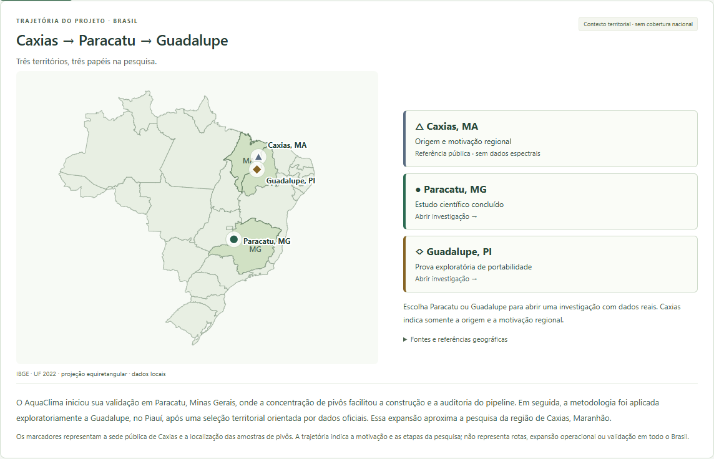
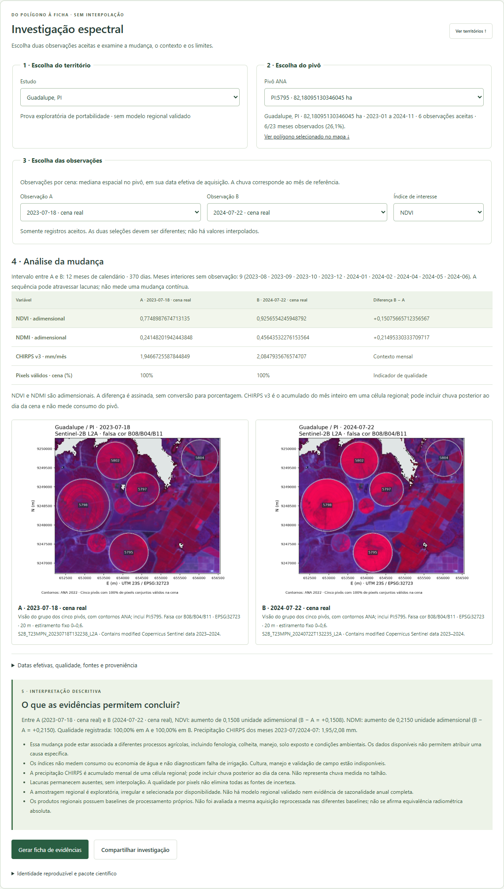

# AquaClima 1.1.0 — auditoria final e preparação da entrega FTL

Referência: **17/11/2026**, America/Sao_Paulo. Prazo oficial: **24/11/2026**. Esta finalização não acrescenta funcionalidades ou resultados científicos. A versão de aplicação continua em **1.1.0**, contrato WebGIS **1.0.0**.

## Versão efetivamente publicada

- Site: [AquaClima no GitHub Pages](https://altaeir-13.github.io/FTL-Final-Project/).
- Commit da `main`: `ad107d0c29c63ad9eb9f91a5970d96906676e3df`, merge manual do [PR #3](https://github.com/Altaeir-13/FTL-Final-Project/pull/3).
- [Workflow de produção 44067496065](https://github.com/Altaeir-13/FTL-Final-Project/actions/runs/44067496065): ciência, frontend, build, navegador e deployment concluídos com sucesso em 17/11.
- Os materiais desta auditoria são preparados na branch `codex/aquaclima-release-ftl`, separada da `main`. A release proposta é **v1.1.0-ftl**, em rascunho para revisão, com alvo no commit público acima. Não há merge automático, publicação dessa release ou submissão pelo agente.

A árvore local estava limpa no início. `git fetch origin`, atualização da `main` por fast-forward e criação da branch de finalização preservaram as branches e os arquivos locais existentes. Não foi necessário stash, reset ou reescrita de histórico.

## Testes contra o site público

Foram executados os **25 testes Playwright diretamente em HTTPS**, sem iniciar ou reutilizar servidor local. O mecanismo existente de `PLAYWRIGHT_BASE_URL` elimina `webServer` da configuração. Resultado: **25 aprovados, zero ignorados, zero falhas e zero instabilidades**, duração **57,011 s**, Microsoft Edge 157.0.4341.60. Os cenários incluem viewport desktop de 1440 px e móvel de 390 px; são emulações de navegador, sem alegar ensaio em aparelho físico.

O [resultado por cenário](evidencias/playwright-publico.json) registra os testes efetivos. A [captura pública adicional](evidencias/capturas-publicas.json) conserva requisições, valores reais, IDs, links, datas de geração e hashes dos arquivos. Os fluxos normais não tiveram erros de console, exceções ou dependências HTTP externas. Os cenários de corrupção/ausência usam falhas simuladas controladas para verificar a resposta segura da interface.

Foram conferidos Paracatu e Guadalupe, geometrias, índices e diferenças contra os arquivos de origem, granularidade mensal/cena, chuva, qualidade, lacunas, rejeições, proveniência, imagens exatas, mensagens de imagem ausente, estado por URL, links anteriores, parâmetros inválidos, hash divergente, independência da ficha, acionamento e CSS de impressão, cinco passos da demonstração, Escape e restauração, teclado, redução de movimento e layout móvel. Não foi identificado defeito funcional que justificasse modificar o aplicativo.





## Integridade pública e científica

A [auditoria de bytes publicados](evidencias/integridade-publica.json) recuperou os **24 arquivos efetivamente servidos** e confirmou igualdade byte a byte com o artefato estático validado. O artefato de deployment contém ainda `.nojekyll`, marcador vazio usado no processo de publicação. O Pages retorna 404 para esse marcador, que não é solicitado pelo aplicativo. Essa distinção está explicitamente registrada; não se atribui um hash remoto fictício ao marcador.

| Identidade | SHA-256 |
|---|---|
| Artefato completo de build, 25 arquivos | `30c96116b9f84daa8dfee0fe4fa3dbd4a7457d2895524d423e56c44f89f8ba3f` |
| Pacote público Paracatu | `7a072a6e29688039b5b775663262ecf6338b35c41386264e75ee789f93068a4d` |
| Manifesto público Paracatu | `69fb2f8083daaf2cc8bcb4b062bb922d36b40ea849468b778d3397aae1ae49b8` |
| Pacote regional Guadalupe | `8d7a54f09174e5890f8a8babf153df855699c727d639b7868a94a658a7495131` |
| Catálogo regional | `afda1abd42ddc472c83db3f6b3953f18e86b19dea954200731f7fb4e70b7384b` |

`data:validate`, `regions:validate` e `verify:dist` foram aprovados localmente. Os logs do deployment também confirmam **216 testes Python**, **60 testes frontend**, **cinco testes de política**, **25 testes Chromium em 23,6 s**, build e o mesmo digest de artefato. Esses totais da CI são distintos da nova execução pública em Edge.

Não há alterações desta auditoria em `web/src/**`, `web/data/**`, `web/regions/**`, `src/**`, configurações científicas, evidências congeladas de Guadalupe ou workflow. Não houve aquisição de rasters, treinamento, reprocessamento analítico ou uso de 2025. A recuperação das imagens PNG já publicadas para navegação e conferência de integridade não é uma nova aquisição científica Sentinel-2.

## Documentos e pasta consolidada

A [pasta de entrega](README.md) reúne relatório científico final em PDF com texto selecionável, figuras originais incorporadas, referências, tabelas e paginação; apresentação editável da Fase 7; PDF de apoio dos oito slides; roteiro e perguntas da banca; fichas A4 exemplificativas de Paracatu e Guadalupe; links públicos, checklist, evidências de auditoria e manifestos SHA-256. O ZIP adjacente permite copiar o conjunto sem depender dos arquivos fora da pasta.

A revisão do relatório se limita à atualização da situação de publicação e ao formato de exportação, preservando os números e as conclusões científicas. A [revisão da apresentação](REVISAO-APRESENTACAO.md) confere os oito slides, as métricas, fontes, imagens e a correspondência com o roteiro. Os binários anteriores da apresentação foram conservados. Seu PDF é um **backup raster**, enquanto o relatório e as fichas têm texto selecionável.

O relatório possui **13 páginas A4**, **seis figuras**, **seis tabelas**, **22 marcadores de seção** e **48 anotações de link**. A conferência verificou **235 blocos** de texto, células, legendas e referências contra o Markdown, sem ausências. Todas as páginas foram renderizadas e inspecionadas, assim como as nove páginas das duas fichas. O [registro de fidelidade](evidencias/fidelidade-relatorio.json) conserva os hashes e a estrutura da exportação. O SHA-256 do relatório é `cd771484662b9833aac8ba314da8c33cc8a6a0adefdd36bfe107cc529f96a813`.

As fichas foram geradas pelo próprio site publicado, usando Paracatu/8087 em julho de 2023 e julho de 2024, e Guadalupe/PI:5795 em 18/07/2023 e 22/07/2024. Elas registram a seleção, hash do pacote, data própria de geração em UTC e identidade determinística. Não são laudos nem diagnósticos agronômicos.

## Reprodução da auditoria

```powershell
Set-Location web
$env:PLAYWRIGHT_BASE_URL='https://altaeir-13.github.io/FTL-Final-Project/'
$env:PLAYWRIGHT_CHANNEL='msedge'  # omitir para Chromium instalado
npm run test:browser
node scripts/audit-public-release.mjs
node scripts/capture-public-release.mjs
```

Os dois scripts são utilitários de auditoria e não modificam o aplicativo publicado. `audit-public-release.mjs` requer `web/dist/` previamente compilado da versão auditada. As capturas e PDFs gerados novamente terão data de geração própria. As instruções de exportação do relatório estão no script `scripts/export_final_report.py`; as dependências de documentos vêm do runtime documentado, sem alterar o ambiente científico.

Para remontar e verificar o pacote, na raiz do repositório:

```powershell
# Python do runtime com ReportLab/Pillow/pypdf e Pandoc para refazer o PDF:
python scripts/export_final_report.py
# Após renderizar e revisar qualquer PDF regenerado, atualizar seu registro de fidelidade.
python scripts/prepare_ftl_delivery.py
python scripts/prepare_ftl_delivery.py --verify-only
python entrega/aquaclima-ftl-2026/VERIFICAR.py
```

O montador recusa hashes de auditoria obsoletos e arquivos não declarados. Os membros do ZIP usam timestamps fixos; remontar os mesmos documentos e evidências preserva seus bytes. Uma nova geração de ficha ou relatório pode alterar seus metadados de criação e, portanto, os hashes dos documentos, sem alterar resultados científicos. Os documentos Markdown copiados têm links adaptados à pasta ou a suas referências públicas. O checksum do ZIP fica fora do próprio arquivo, em `entrega/SHA256SUMS.txt`.

## Limitações remanescentes e decisão do responsável

Paracatu conserva o estudo concluído de cinco pivôs e Guadalupe conserva a prova exploratória de 29 observações em seis datas, sem modelo regional validado. Caxias representa origem e motivação, sem observações processadas. Fenologia, manejo, colheita, solo e ambiente podem influenciar os índices. Não há validação de falhas de irrigação, consumo ou economia de água, retorno financeiro ou cobertura operacional brasileira.

A impressão foi conferida em Chromium/Edge; outros navegadores ou drivers podem paginar de forma diferente. O teste de 390 px não substitui ensaio em celular físico. O PPTX foi conferido por estrutura, evidências e renderização, sem afirmar abertura no PowerPoint nativo. O PDF dos slides permanece raster. Instruções oficiais de envio/template e limites de arquivo precisam ser confirmados pelo autor.

Cabem exclusivamente ao responsável: revisar e aprovar os materiais e a release em rascunho; decidir o merge da documentação; conferir PPTX no editor e no projetor; ensaiar cinco minutos de slides e três de demonstração; confirmar regras de envio; congelar a versão de submissão em **23/11**; realizar a submissão oficial em **24/11** e guardar seu comprovante. Nenhuma dessas ações humanas é marcada como concluída pelo agente.
